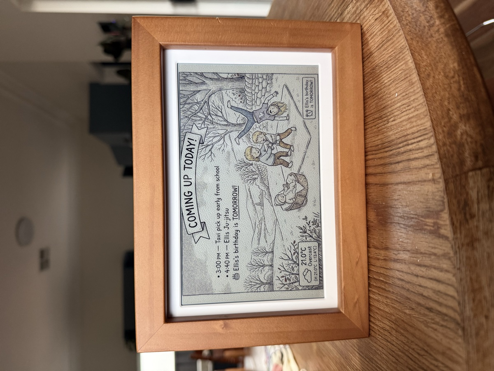

# Glanceboard

**A daily calendar your kids actually look at.**

Glanceboard turns your Google Calendar into AI-generated art on an e-ink display. No screens. No notifications. Just a quiet picture frame that helps your family know what's happening today.



---

## Why I built this

I wanted to empower my kids to be more independent in the mornings — to know what's on today, what to pack in their bags, what to wear without asking and without giving them a screen to check.

I couldn't find anything that did this well, so I built Glanceboard. It reads our family calendar and generates a new illustrated scene every morning with the day's events, weather, and our characters on it.

My kids love it. They get excited every morning to see what the picture looks like and read what's coming up. It's become part of our routine.

It uses AI image generation, so sometimes the pictures do weird things. The kids think that's funny. So do I.

---

## How it works

Glanceboard runs a lightweight local server on your computer (or a Raspberry Pi). Every few hours, it:

1. Reads your calendar events via iCal URL
2. Fetches the current weather for your location
3. Builds a creative prompt with your family's characters
4. Generates an illustrated daily planner using Gemini
5. Dithers the image for 6-colour e-ink and serves it to your display

The display polls the server for new images — no cloud account needed.

---

## What you need

| Part | Description | Price |
|------|-------------|-------|
| [**Waveshare ESP32-S3 PhotoPainter**](https://www.waveshare.com/esp32-s3-touch-lcd-7.htm) | 7.3" colour e-ink display in a wooden frame with built-in WiFi | ~$90 |
| **USB-C cable** | For power (or use an optional lithium battery) | ~$5 |
| **A computer or Pi** | To run the Glanceboard server (anything that runs Python) | — |

No soldering. No ribbon cables. Just one display and a server.

> **Using a Raspberry Pi as the display?** The legacy Pi + separate e-ink HAT setup is still supported — see [Legacy Pi Setup](pi/LEGACY_PI_SETUP.md).

---

## Features

- **AI-generated daily art** — Your calendar events become illustrated daily planners
- **6 art styles** — Pen-and-ink, fashion sketch, watercolour, pixel art, comic book, and Japanese sumi-e
- **Custom characters** — Add people and pets with reference photos for consistency
- **Drag-and-drop widgets** — Add sports scores, stock tickers, news, daily quotes, weather, and more to your display layout
- **Google Calendar** — Connect via iCal URL (any calendar that exports iCal works — Google, Outlook, Apple)
- **Weather-aware** — Shows weather on the display; characters dress for the actual conditions
- **Location-aware** — Uses your location to generate regionally accurate scenes (no snow in Sydney!)
- **Smart countdowns** — AI scans your calendar for birthdays, trips, and holidays to count down to
- **Gemini-powered event rewriting** — Turns "9am Tavi Library Bag" into "Tavi — remember library bag!"
- **E-ink ready** — Floyd-Steinberg dithered for 6-colour Spectra panels
- **Smart scheduling** — Auto-generates at your chosen times, only when your calendar or weather changes
- **Custom prompts** — Edit the image generation prompt template
- **Fully local** — Runs on your own machine, no cloud account required

---

## Quick start

### 1. Clone and install

```bash
git clone https://github.com/raphdixon/glanceboard.git
cd glanceboard

# Install server dependencies
cd server
python3 -m venv venv
source venv/bin/activate
pip install -r requirements.txt
cd ..

# Install and build the web dashboard
cd web
npm install
npm run build
cd ..
```

### 2. Start the server

```bash
cd server
source venv/bin/activate
python3 -m uvicorn app:app --host 0.0.0.0 --port 8000
```

Open [http://localhost:8000](http://localhost:8000) — the Glanceboard dashboard will guide you through setup:

- **API key** — Enter your Google AI Studio key (see [API key setup](#api-key-setup) below)
- **Calendar** — Paste your iCal URL
- **Location** — Set your timezone and location for weather
- **Art style** — Choose from 6 styles
- **Characters** — Add your family members and pets

### 3. Set up the display

See [Display setup guide](#display-setup-guide) below to flash and connect your PhotoPainter.

---

## Suggested models

Glanceboard works with a range of AI image generation models:

| Model | Provider | Est. Cost/Image | Notes |
|-------|----------|-----------------|-------|
| **Gemini 3 Pro** | Google AI Studio | ~$0.04 | **Recommended.** Best quality, great text rendering and character consistency. |
| **Gemini 3.1 Flash Lite** | Google AI Studio | ~$0.01 | Fast and cheap. Good for frequent refreshes on a budget. |

Glanceboard also uses **Gemini 3.1 Flash Lite** (essentially free) for text intelligence:
- Rewriting calendar events into friendly language
- Generating weather-accurate scene descriptions
- Scanning calendars for important upcoming events

---

## API key setup

Glanceboard needs a **Google AI Studio API key** to generate images. This is the only ongoing cost (~$1–3/month).

1. Go to [aistudio.google.com/apikey](https://aistudio.google.com/apikey)
2. Click **Create API Key** → select your Google Cloud project (or create one)
3. Copy the key (starts with `AIza...`)
4. Paste it into the Glanceboard dashboard during onboarding

> **That's it.** The key is stored locally in your `server/data/config.json` file and used server-side to call the Gemini API. You are billed directly by Google for API usage.

---

## Display setup guide

### Step 1: Flash the Glanceboard firmware

The PhotoPainter ships with stock firmware. You need to flash the Glanceboard firmware to enable QR code setup and automatic image polling.

1. Connect your PhotoPainter to your computer via USB-C
2. Hold the **BOOT** button, then press **RESET** while holding BOOT — release both
3. Download the latest `merged.bin` from [Releases](https://github.com/raphdixon/glanceboard-firmware/releases)
4. Flash using [esptool](https://docs.espressif.com/projects/esptool/en/latest/):
   ```bash
   python3 -m esptool --chip esp32s3 --port /dev/cu.usbmodem* --baud 921600 write_flash 0x0 merged.bin
   ```
5. The device will reboot and show the Glanceboard setup screen

> **Important:** Keep the SD card inserted — the firmware needs certain system files to boot properly.

### Step 2: Connect to WiFi (scan QR code)

1. Power on the PhotoPainter — the Glanceboard setup screen appears
2. On your phone, scan the **left QR code** ("Scan to connect WiFi")
3. Your phone connects to the Glanceboard's WiFi hotspot
4. A captive portal opens — enter your home WiFi network and password
5. The device connects and shows a "Ready!" screen

### Step 3: Point the display at your server

1. Open the device's web interface (shown on the "Ready!" screen)
2. Set the **image URL** to your Glanceboard server's display endpoint — e.g. `http://192.168.1.x:8000/images/latest_display.png`
3. Set the polling interval (e.g. 300 seconds)
4. Generate your first image from the dashboard — the display will fetch and show it!

### Factory Reset

If you need to start fresh (e.g. change WiFi, transfer to a new owner):
- **Hold the BOOT button for 10 seconds** — the device wipes all settings and reboots to the setup screen
- Alternatively, access the device's web interface and use `POST /api/factory-reset`

---

## Architecture

```
Local Server (FastAPI on Python 3.11+)
──────────────────────────────────────────────────────
  server/app.py
  ├── /api/config        GET/POST — settings
  ├── /api/generate      POST — trigger image generation
  ├── /api/status        GET — generation status
  ├── /api/preview       GET — preview the prompt
  ├── /images/*          static — generated display images
  └── /*                 static — built Vite SPA dashboard

  data/config.json       local config (API key, calendar, etc.)
  data/images/           generated display images

  Scheduler (APScheduler)
  └── runs every 15 min, generates at user-chosen hours
      only when calendar/weather has changed

  Web Dashboard (Vite SPA)
  ├── Onboarding wizard
  ├── Settings panel
  ├── Drag-and-drop widget layout editor
  ├── Character manager
  └── Live display preview
──────────────────────────────────────────────────────
         │                              │
         ▼                              ▼
  ESP32-S3 PhotoPainter         AI Provider
  polls /images/latest_*        Google AI Studio
  updates e-ink display         (Gemini Flash / Pro)

  Gemini 3.1 Flash Lite
  • Rewrites calendar events in friendly text
  • Generates weather-accurate scene prompts
  • Scans calendar for important countdowns
```

---

## Project structure

```
glanceboard/
├── server/                     # Local Python server (FastAPI)
│   ├── app.py                  # All backend logic + API endpoints
│   ├── requirements.txt        # Python dependencies
│   └── data/                   # Runtime data (gitignored)
│       ├── config.json          # Your settings (gitignored)
│       ├── config.example.json  # Template config
│       └── images/              # Generated display images (gitignored)
├── web/                        # Frontend (Vite SPA)
│   ├── index.html              # Dashboard + landing page
│   └── src/
│       ├── main.js             # App logic
│       ├── style.css           # Styles
│       ├── config.js           # Firebase config (gitignored, only for hosted version)
│       └── config.example.js   # Template config
├── functions/                  # Cloud Functions (for hosted version)
│   ├── main.py                 # Backend logic (Firebase variant)
│   └── requirements.txt        # Python dependencies
├── firmware/                   # ESP32-S3 PhotoPainter docs
│   └── README.md               # SD card & firmware setup
├── pi/                         # Legacy Raspberry Pi scripts
│   ├── LEGACY_PI_SETUP.md      # Pi setup guide
│   ├── install.sh              # One-line installer
│   └── display_update.py       # Display update script
├── firestore.rules             # Firestore security rules (hosted version)
├── storage.rules               # Storage security rules (hosted version)
├── firebase.json               # Firebase config (hosted version)
├── SELF_HOSTING.md             # Firebase self-hosting guide
└── LICENSE                     # CC BY-NC 4.0
```

---

## Contributing

Contributions are welcome! Please:

1. Fork the repository
2. Create a feature branch (`git checkout -b feature/amazing-thing`)
3. Commit your changes
4. Push to the branch
5. Open a Pull Request

---

## License

[CC BY-NC 4.0](LICENSE) — free to use, fork, and modify for non-commercial purposes. For commercial licensing, contact the author.

---

Built with ❤️ by [Raph Dixon](https://raph.plus).
